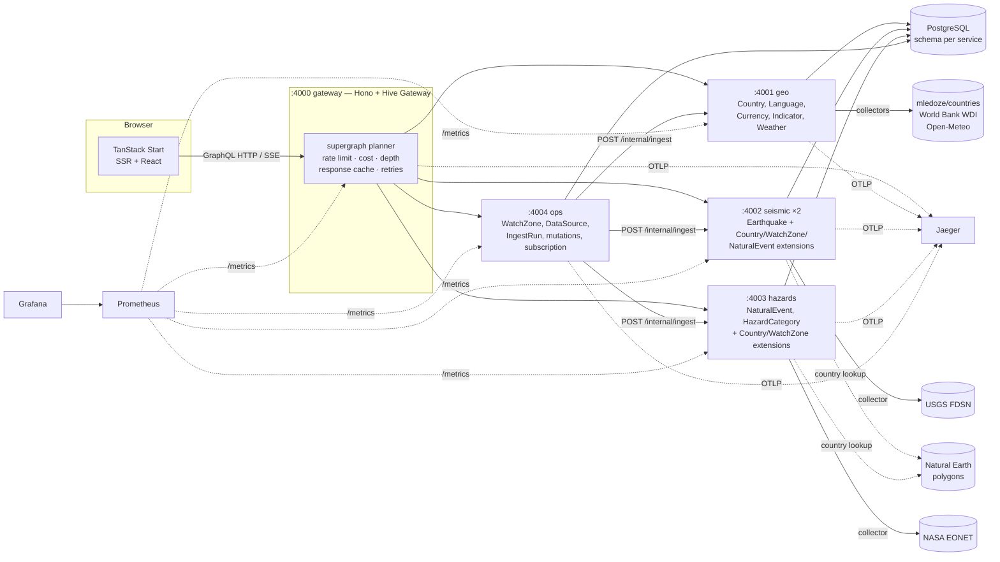

# GeoPulse — федеративный GraphQL-мониторинг природных явлений

Клиент-серверное приложение: землетрясения, природные события (пожары, штормы, вулканы,
наводнения, льды) и страны мира в едином GraphQL API. Данные автоматически собираются из пяти
внешних источников, бэкенд разбит на четыре subgraph-сервиса за шлюзом Apollo Federation v2.

**Стек:** Hono · GraphQL Yoga · Apollo Federation 2 (Hive Gateway) · PostgreSQL 17 ·
TanStack Start + TanStack Query/Router · shadcn/ui · OpenTelemetry + Jaeger · Prometheus + Grafana.

## Архитектура



Каждый subgraph — отдельный Hono-сервер с GraphQL Yoga и `@apollo/subgraph`. Сервис владеет
своей схемой в Postgres (`geo`, `seismic`, `hazards`, `ops`), своими миграциями и своими
сборщиками. Связи между доменами сделаны через федеративные сущности:

| Сущность | Владелец | Расширяют |
| --- | --- | --- |
| `Country @key(code)` | geo | seismic (`earthquakes`, `seismicStats`, `recentEarthquakes`), hazards (`naturalEvents`, `hazardStats`) |
| `WatchZone @key(id)` | ops | seismic (`earthquakes`, `earthquakeCount` через `@requires(latitude longitude radiusKm minMagnitude)`), hazards (`naturalEvents` через `@requires`) |
| `NaturalEvent @key(id)` | hazards | seismic (`nearbyEarthquakes` через `@requires(latitude longitude startedAt)`) |
| `Earthquake @key(id)` | seismic | — (ссылается на `Country`) |

Пример одного запроса, который проходит через все четыре сервиса:

```graphql
{
  country(code: "JPN") {                       # geo
    name population weather { temperatureC }   # geo (Open-Meteo)
    neighbors { name seismicStats { count } }  # geo → seismic
    seismicStats { count strongest { place } } # seismic
    hazardStats { byCategory { category { title } count } } # hazards
  }
  watchZones { name earthquakeCount(days: 30) naturalEventCount(days: 30) } # ops → seismic, hazards
  dataSources { name health recordCount }      # ops
}
```

## Источники данных (≥ 3, ≥ 10 000 записей)

| Источник | Сервис | Что собирается | Записей* | Обновление |
| --- | --- | --- | --- | --- |
| [USGS FDSN Event API](https://earthquake.usgs.gov/fdsnws/event/1/) | seismic | землетрясения M2.5+ за 24 месяца | ~59 000 | каждые 5 мин |
| [NASA EONET v3](https://eonet.gsfc.nasa.gov/) | hazards | события с 2019 г., треки, источники | ~10 800 событий + 24 000 точек + 11 500 ссылок | каждые 15 мин |
| [World Bank WDI](https://data.worldbank.org/) | geo | 8 индикаторов × 296 экономик × 1995–2025 | ~65 000 | раз в сутки |
| [mledoze/countries](https://github.com/mledoze/countries) | geo | 250 стран, 153 языка, валюты, границы, переводы | ~1 250 | раз в сутки |
| [Open-Meteo](https://open-meteo.com/) | geo | текущая погода в 250 столицах | 250 | каждые 30 мин |
| [Natural Earth](https://www.naturalearthdata.com/) | seismic, hazards | полигоны стран для привязки точки к стране | — | при старте |

\* после первого полного сбора; итог виден в `totalRecords` и на странице «Сбор и мониторинг» (~160 тыс.).

Сборщики (`services/*/src/collector*.ts`) построены на общем фреймворке `packages/shared/src/ingest.ts`:

- первый запуск — полный бэкфилл (по месяцам или кварталам), с контрольными точками в `ops.ingest_checkpoints`, поэтому после падения сбор продолжается с места остановки; дальше идут инкрементальные обновления;
- идемпотентные `INSERT … ON CONFLICT DO UPDATE` пачками;
- `pg_try_advisory_lock` выбирает лидера, так что из двух реплик seismic собирает только одна;
- у внешних запросов есть таймаут, повтор с экспоненциальной задержкой и джиттером, а также circuit breaker на каждый источник;
- журнал запусков пишется в `ops.ingest_runs`, прогресс рассылается через `pg_notify`.

## Соответствие требованиям

| Требование | Реализация |
| --- | --- |
| 1. Только GraphQL | Веб ходит только в `POST/GET :4000/graphql` (запросы, мутации, подписки по SSE). SSR тоже обращается к шлюзу по GraphQL. REST есть лишь у внутренних служебных эндпоинтов (`/health`, `/metrics`, `/internal/ingest` с сервисным токеном) |
| 2. ≥ 3 источника, ≥ 10 000 записей, разнообразие | 5 API + Natural Earth, около 160 тыс. записей: события, временные ряды, геометрия, справочники, погода |
| 3. Разные операции, вложенность, динамика | Query, Mutation (`createWatchZone`, `updateWatchZone`, `deleteWatchZone`, `triggerIngest`, ошибки в payload), Subscription (`earthquakeDetected`, `ingestRunUpdated` через Postgres LISTEN/NOTIFY между репликами). Вложенность на 4–5 уровней через сервисы. Страница «Конструктор запросов» собирает документ из выбранных полей, аргументов и `@include(if:)` |
| 4. Фильтрация, сортировка, поиск, пагинация | Фильтры-инпуты (диапазоны, массивы, гео-радиус `near`, период, флаги), сортировка по 5–6 полям, поиск через `ILIKE` с trigram-индексами. Курсорная keyset-пагинация (Relay `Connection`, `totalCount` считается лениво) для больших коллекций и offset-пагинация для стран. Состояние хранится в URL |
| 5. Производительность | Keyset-индексы под каждую сортировку, GiST-индекс `earthdistance` для радиусных запросов, DataLoader-батчинг (сущности и `seismicStats` для N стран одним `GROUP BY`, `recentEarthquakes` через `row_number() over (partition …)`), материализованное представление `geo.country_facts`, кеш ответов на шлюзе с TTL по координатам схемы и инвалидацией по мутациям, дедупликация одинаковых входящих запросов, gzip, SSR с гидратацией кеша TanStack Query |
| 5. Отказоустойчивость | 2 реплики seismic; ретраи и таймауты к subgraph-ам на шлюзе; nullable-расширения сущностей, поэтому при падении сервиса приходит частичный ответ, а UI показывает «Часть данных недоступна»; шлюз хранит последний удачный супер-граф и откатывается к собранному на этапе сборки `supergraph.graphql`; healthcheck/readiness и `restart: unless-stopped`; корректное завершение по SIGTERM; автопереподключение к БД; ретраи в TanStack Query и Error Boundary |
| Доп. 1. Нагрузка, мониторинг, трассировка | Token bucket по IP (429 + `Retry-After`), сброс нагрузки при превышении числа одновременных запросов (503), отдельные лимиты на дорогие поля и мутации, demand control (`@cost`/`@listSize`, максимум 20 000), лимиты глубины, алиасов и токенов, `requestDeadline`. Prometheus-метрики шлюза, subgraph-ов и сборщиков, алерты и дашборд Grafana. OpenTelemetry-трейсы шлюз → subgraph → SQL/HTTP в Jaeger, `traceId` в логах pino. Инспектор запросов в UI показывает время, стоимость и попадание в кеш |
| Доп. 2. Federation и распределённость | Apollo Federation v2.9: `@key`, `@external`, `@requires`, `@shareable`, `@cost`, `@listSize`. Композиция `@theguild/federation-composition` с опросом subgraph-ов раз в 30 с. Четыре независимых сервиса со своими схемами БД и миграциями. Команда `triggerIngest` идёт из ops в сервис-владелец; события распространяются через Postgres NOTIFY |

## Запуск

Требуется Docker. Первый полный сбор занимает 2–4 минуты (World Bank отвечает медленно).

```bash
docker compose up -d --build
```

| Что | URL |
| --- | --- |
| Веб-приложение | http://localhost:3100 |
| GraphQL (GraphiQL) | http://localhost:4000/graphql |
| Grafana (дашборд «GeoPulse») | http://localhost:3001 |
| Jaeger | http://localhost:16686 |
| Prometheus | http://localhost:9090 |

### Локальная разработка

```bash
bun install
docker compose up -d postgres jaeger prometheus grafana
./scripts/dev-backend.sh            # 4 subgraph-а + шлюз
bun run --cwd apps/web dev          # http://localhost:3100
```

После изменения схемы subgraph-а:

```bash
bun run compose    # supergraph.graphql + схема для фронтенда
bun run codegen    # типизированные документы (GraphQL Codegen, client preset)
```

### Проверки

```bash
bun run typecheck
bun run test                               # unit: пагинация, circuit breaker, ретраи, классификация
bun test apps/gateway/test                 # e2e против запущенного стека
bun scripts/load-test.ts 600 40            # нагрузка: латентность, 429/503, попадания в кеш
```

Сценарии отказов для демонстрации:

```bash
docker kill geopulse-seismic-1    # запросы обслуживает вторая реплика
docker stop geopulse-hazards-1    # страница страны отдаётся без блока «Природные события»
docker start geopulse-hazards-1
```

## Структура

```
apps/
  gateway/        Hono + Hive Gateway: композиция, контроль нагрузки, кеш, метрики, трейсы
  web/            TanStack Start + shadcn/ui, GraphQL Codegen, SSE-подписки
services/
  geo/            страны, языки, валюты, индикаторы WB, погода
  seismic/        землетрясения USGS (2 реплики)
  hazards/        природные события NASA EONET
  ops/            зоны наблюдения, реестр источников, журнал сбора, запуск сборщиков
packages/shared/  БД и миграции, subgraph-сервер, ingest-фреймворк, HTTP с ретраями и
                  circuit breaker, keyset-пагинация, гео-поиск, телеметрия
infra/            Dockerfile, Postgres init, Prometheus (+алерты), Grafana (провижининг)
scripts/          локальный запуск бэкенда, нагрузочный тест
```
